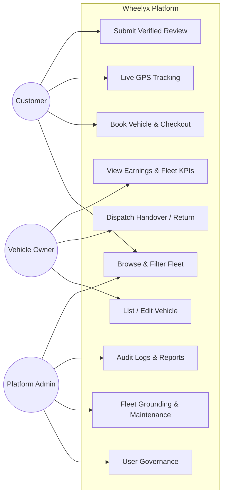
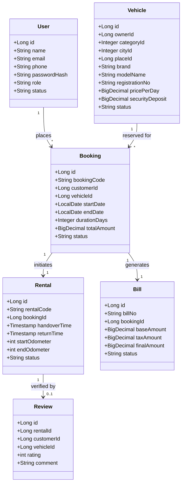
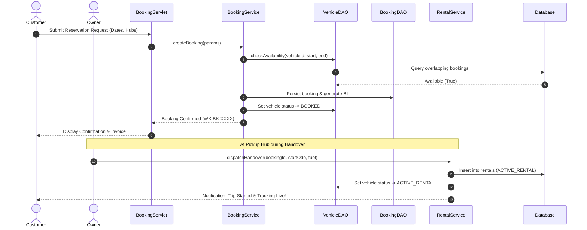

# Component 03: System Design — UML & ER Models

## 1. Architectural Overview
Wheelyx is designed using an enterprise **Layered Architecture** adhering to the **Model-View-Controller (MVC)** design pattern:

```
[Presentation Layer]   JSP 3.1, JSTL, Bootstrap 5.3, Vanilla JavaScript, Chart.js
         │
         ▼ (HTTP Requests & Session Cookies)
[Security Filter Layer] CustomerAuthFilter, OwnerAuthFilter, AdminAuthFilter, CharsetEncodingFilter
         │
         ▼
[Controller Layer]      38 Jakarta Servlets (@WebServlet annotated controllers)
         │
         ▼
[Service Layer]         BookingService, RentalService, AuthService, FleetService, BillingService, etc.
         │
         ▼
[Data Access Layer]     15 Data Access Objects (DAO) executing Parameterized PreparedStatements
         │
         ▼
[Connection Pool Layer] HikariCP Connection Pool (Min: 5, Max: 20)
         │
         ▼ (TCP Port 3306)
[Database Layer]        MySQL 8.0 Engine (InnoDB, UTF-8 MB4)
```

---

## 2. Diagram Resources & Sources
- Raw Mermaid diagram source code is available in [`mermaid_source/`](mermaid_source/):
  - [`use_case_diagram.mmd`](mermaid_source/use_case_diagram.mmd)
  - [`class_diagram.mmd`](mermaid_source/class_diagram.mmd)
  - [`sequence_booking.mmd`](mermaid_source/sequence_booking.mmd)
  - [`er_diagram.mmd`](mermaid_source/er_diagram.mmd)
- Visual diagram exports are located in [`images/`](images/).

---

## 3. Platform Use-Case Model



---

## 4. Class Diagram & Entity Relationships



---

## 5. Sequence Diagram: Booking & Handover Lifecycle


